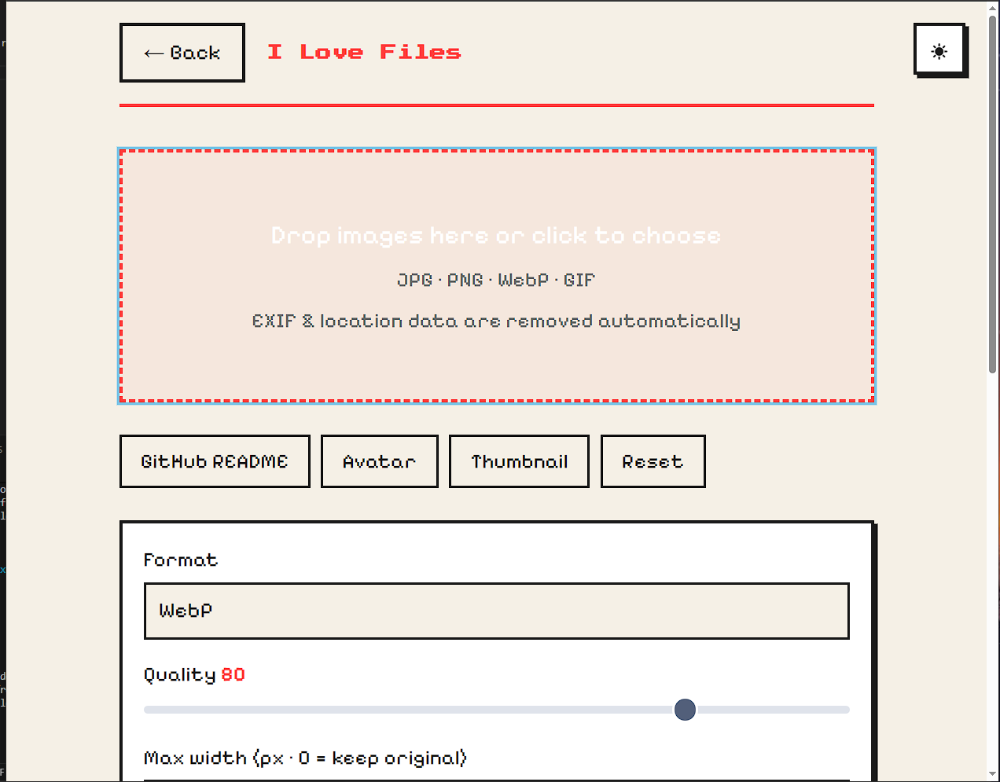

## I ♥ Files

A local image converter and compressor that runs entirely in your browser. 
URL : https://ilovefilesbyhemanth.netlify.app/



## Features

-Nothing leaves your device.
-No internet required.
-Compress,rotate,convert(JPEG,PNG,WebP,Gif)
-Light and Dark mode
-Pixel themed

## How it works?

Using canvas API it compresses your images to the desired quality using binary search.

## Architecture 
This is generated using file structure commands.

```
 ILoveFiles
├── .vscode
│   └── settings.json
├── README.md
├── css
│   └── style.css
├── icons
│   ├── favicon.png
│   └── heart.png
├── images
│   └── screenshot1.png
├── index.html
├── js
│   ├── action.js
│   ├── compare.js
│   ├── conversion-core.js
│   ├── converter.js
│   ├── downloader.js
│   ├── dropzone.js
│   ├── filelist.js
│   ├── format-support.js
│   ├── loader.js
│   ├── main.js
│   ├── presets.js
│   ├── settings.js
│   ├── state.js
│   ├── theme.js
│   ├── views.js
│   ├── worker.js
│   └── zip.js
├── manifest.webmanifest
└── sw.js
```

## Privacy

This website doesn't upload anything to cloud like other compression things does. it runs in browser but can be little less responsive. In return you get max privacy, not even a pixel leaves your device, btw runs on airplane mode if someone wants so.

And this does not make any network requests as even Pico (css), Zip

## Installation

### Use in browser 
*You can Run this directly in your browser*

Open : https://ilovefilesbyhemanth.netlify.app/ 
and use it, copy images might not work on some browsers though.

### Installation for Computer users.

Open the URL https://ilovefilesbyhemanth.netlify.app/ 

and click ctrl + s to save it. That's it. Now you can run it without any internet 

### Installation for Mobile users.

Open the URL
https://ilovefilesbyhemanth.netlify.app/ 

and click on the three dots on top right corner and press "Install and create shortcut". If not available in google, open this link in Chrome.

## AI usage 
Used AI for mainly debugging and assistance in CSS and JS. Didn't copy paste entire code.
## License

MIT. Do whatever you want, but don't create a black hole out of it.
